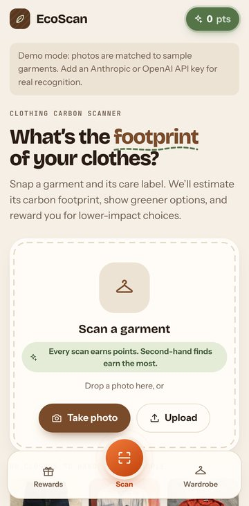
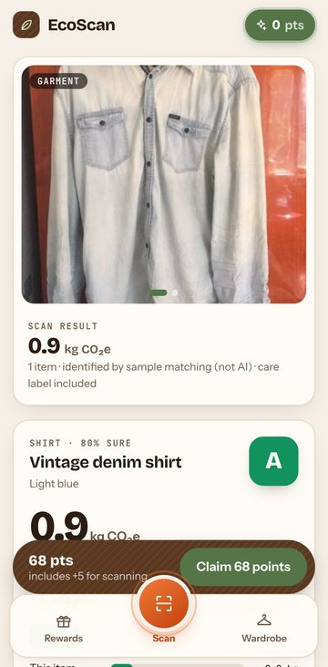
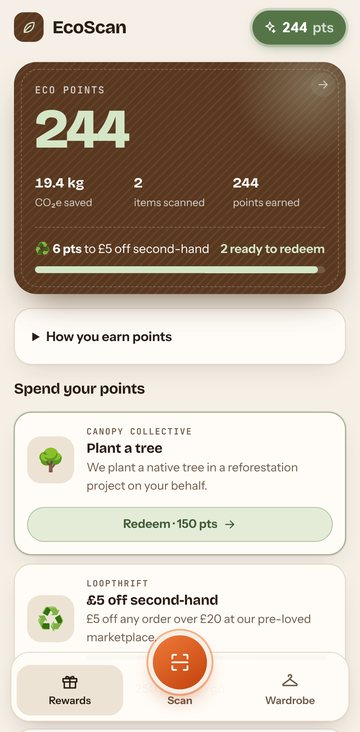
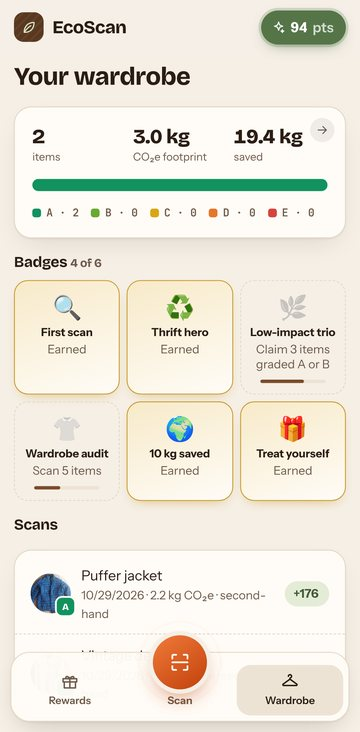
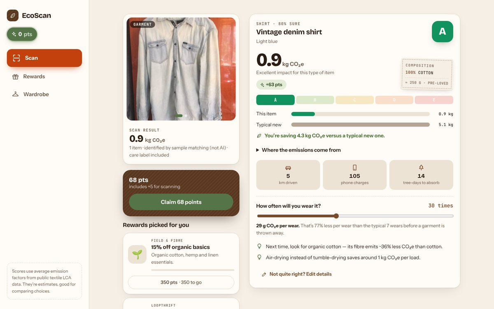

# 🌍 EcoScan — Clothing Carbon Footprint Scanner

## 📜 Overview

EcoScan helps people understand the environmental impact of their clothes. Take a photo of a garment (and, optionally, its care label) and EcoScan:

1. **identifies each clothing item** in the photo with a vision model (Claude, Gemini or GPT-4o, or an offline mock),
2. **estimates its carbon footprint** from its type, materials, weight and condition,
3. **grades it A–E** against a typical new item of the same kind and shows where the emissions come from,
4. **awards eco-reward points** for the CO₂e it saves compared with that typical item, and
5. **shows offers** the user can redeem with those points (tree planting, repairs, second-hand vouchers…).

<p align="center">
  
  
  
  
</p>
<p align="center">
  
</p>

**Contents:** [Tech stack](#-tech-stack) · [Requirements checklist](#-requirements-checklist) · [Setup](#-setup-instructions) · [Run](#%EF%B8%8F-run-instructions) · [Tests](#-testing) · [API](#-api-reference) · [Carbon assumptions](#-carbon-score-assumptions) · [Code structure](#-code-structure) · [Design decisions](#-design-decisions) · [Enhancements](#-product--technical-enhancements) · [Deployment](#-deployment)

---

## 🔧 Tech Stack

| Layer | Choice |
| --- | --- |
| **Frontend** | React 19 + TypeScript, Vite. Hand-written CSS (no UI kit), responsive from 320 px phones to wide desktops, light and dark mode. |
| **Backend** | Node.js + Express 5 + TypeScript. `zod` validates every request; `multer` handles uploads. |
| **Image recognition** | **Claude Opus 5.5** (Anthropic SDK, structured outputs) , **Google Gemini** (REST, response schema, automatic model fallback) or **OpenAI GPT-4o** (vision, JSON schema). With no key, a deterministic **mock recognizer** runs so the app works offline. |
| **Storage** | In-memory (a `Map`-backed store), as the brief requires. Optional JSON-file persistence through one env var. |
| **Tests** | Vitest + Supertest (45 tests: 37 backend, 8 frontend). |

---

## ✅ Requirements Checklist

| Brief requirement | Where it lives |
| --- | --- |
| Upload a photo **or take one with the camera** | Scan screen: *Take photo* (live in-app camera viewfinder), *Upload*, drag-and-drop, or one-tap samples. On phones the raised **Scan** button opens the phone's camera app directly. |
| Identify clothing items in the image | `POST /api/scans` → `backend/src/services/recognizer.ts` (Claude / Gemini / GPT-4o / mock). Several items per photo are supported. |
| Carbon footprint per item | `backend/src/services/carbon.ts`, with the factors in `backend/src/data/` |
| Total carbon score + eco-reward points | Returned on every scan (`totalKgCO2e`, `totalSavedKgCO2e`, `totalPoints`) and shown on the result screen |
| Offers based on the user's points | `GET /api/offers` marks each offer `affordable` with `pointsNeeded`; `?affordable=true` returns only redeemable ones. Rewards screen and the result screen's "Rewards picked for you". |
| **Image Analysis endpoint** | `POST /api/scans` (multipart `image`, optional `label`) |
| **Eco-Score Calculation endpoint** | `POST /api/score` (JSON items, no image needed) |
| **Offers Retrieval endpoint** | `GET /api/offers` (+ `POST /api/offers/:id/redeem`) |
| Carbon assumptions in an in-memory dictionary | `CATEGORY_PROFILES` and `MATERIALS` in `backend/src/data/`; see the [assumptions tables](#-carbon-score-assumptions) |
| No database, in-memory storage | `backend/src/services/store.ts`; in-memory unless `DB_PATH` is set |
| Unit tests for core functionality | `backend/test/*.test.ts`, `frontend/src/lib/__tests__/*.test.ts` |
| Error handling (e.g. invalid image upload) | Non-image → 415, missing image → 400, > 10 MB → 400, malformed JSON → 400, invalid items → 400 with details, vision API down, key rejected or quota used up → a clear error message (never a made-up garment); photo with no clothing → "No clothing spotted" |
| README with setup, run, test, assumptions, enhancements | This file |
| Deployment (optional) | See [Deployment](#-deployment) |

---

## 🚀 Setup Instructions

### Prerequisites

- **Node.js 20.19 or newer** (22 LTS recommended; an `.nvmrc` is included). Check with `node -v`.
- **npm 10+** (comes with Node).
- Optional: a **Gemini** (free at https://aistudio.google.com/apikey), **Anthropic** or **OpenAI** API key for real image recognition. Without one, the app runs in demo mode with the mock recognizer.

### 1. Get the code

```bash
# from the zip
unzip ecoscan.zip
cd ecoscan

# or from GitHub
git clone https://github.com/<your-username>/ecoscan.git
cd ecoscan
```

### 2. Install dependencies

One command installs both the frontend and the backend (npm workspaces):

```bash
npm install
```

### 3. Configure environment variables (optional)

```bash
cp backend/.env.example backend/.env        # Windows: copy backend\.env.example backend\.env
```

| Variable | Default | What it does |
| --- | --- | --- |
| `ANTHROPIC_API_KEY` | — | Enables Claude vision (preferred). |
| `ANTHROPIC_MODEL` | `claude-opus-5-5` | Claude model to use. |
| `GEMINI_API_KEY` | — | Enables Gemini vision when no Anthropic key is set. Paste it with no quotes. |
| `GEMINI_MODEL` | empty | Gemini model to try first. By default it tries `gemini-3.8-flash` → `gemini-3.5-flash-lite` → `gemini-flash-latest` → `gemini-flash-lite-latest`, moving on when a model is retired or out of free quota. |
| `OPENAI_API_KEY` | — | Enables GPT-4o vision when no Anthropic or Gemini key is set. |
| `OPENAI_MODEL` | `gpt-4o` | OpenAI model to use. |
| `RECOGNIZER` | `auto` | `auto` = Claude → Gemini → OpenAI → mock, by which key is set. Or force `claude`, `gemini`, `openai` or `mock`. |
| `PORT` | `3001` | API port. |
| `DB_PATH` | empty | Empty = in-memory (resets on restart). Set e.g. `./data/db.json` to persist. |

With no `.env` file at all, everything still works using the mock recognizer. The server reads `backend/.env` and also a `.env` in the project root.

To check your key before starting, run `npm run check`. It sends one sample garment photo through the recognizer and prints the result, or the exact reason it failed (key rejected, free quota used up, model retired…). It uses one request of your quota.

> **Gemini free tier:** about 20 requests per model per day. EcoScan moves on to the next model when one runs out and tells you when the quota resets.

---

## ▶️ Run Instructions

### Option A: development mode (hot reload)

```bash
npm run dev
```

| What | URL |
| --- | --- |
| **App (open this)** | **http://localhost:5173** |
| API | http://localhost:3001/api/health |

Vite proxies `/api` to the backend, so open only the 5173 address.

### Option B: production mode (one server)

```bash
npm run build
npm start
```

Open **http://localhost:3001**. Express serves the built frontend and the API from one origin.

### Trying it out

1. On first visit, a welcome screen appears. Tap **Get started**.
2. Tap a **sample photo** (jeans, denim shirt, sweater…) or use **Take photo / Upload** with your own picture.
3. Optionally **add the care label** photo, then tap **Analyse footprint**.
4. Look at the grade, the footprint breakdown, the greener options and the wear planner. Use **Edit details** to correct the type, condition or materials.
5. **Claim points**, then open **Rewards** (the wallet shows how many points you need for the next reward) to redeem an offer, and **Wardrobe** for totals and badges.

> **Demo mode:** without an API key, photos are matched to sample garments (a garment word in the filename, such as `jeans.jpg`, steers the pick). Add `GEMINI_API_KEY`, `ANTHROPIC_API_KEY` or `OPENAI_API_KEY` for real recognition.
>
> **Opening it on your phone:** keep `npm run dev` running on your computer, connect the phone to the **same Wi-Fi**, and open `http://<your-computer's-IP>:5173` (Vite prints it as the **Network** address). Don't use `localhost` on the phone, because that means the phone itself. If Windows asks, allow Node.js through the firewall. The phone's camera opens through **Take photo**/**Scan**; a live in-page viewfinder needs HTTPS, so deploy the app for that.
>
> **Offline mode:** if the frontend can't reach the API (backend not running, or only the frontend deployed), the app switches to an in-browser mode instead of failing. It uses the same scoring code, keeps data on the device, and matches photos to sample garments. A banner says when this is active.

---

## 🧪 Testing

```bash
npm test                  # all tests (backend, then frontend)
npm test -w backend       # backend only
npm test -w frontend      # frontend only
```

**What's covered (45 tests):**

- **Carbon engine** (`carbon.test.ts`): material aliases and normalisation, baseline grading, lower-impact fibres scoring better, second-hand discount and bonus, high-impact fibres graded E, custom weights, tips, and greener alternatives.
- **API** (`api.test.ts`): the full scan → edit → claim → redeem flow; duplicate photos earning nothing; per-user isolation; the eco-score endpoint; offers by points (`affordable`, `pointsNeeded`, `?affordable=true`); and error cases (non-image, missing image, image over 10 MB, malformed JSON, invalid items, unknown offer, too few points).
- **Recognizer** (`recognizer.test.ts`): the exact Claude request (image blocks, structured-output schema, care-label second image) against a local stub server, refusal handling, unsupported image types, and provider selection.
- **Gemini** (`gemini.test.ts`): the Gemini request (inline image, response schema, system prompt) against a local stub server, skipping retired and out-of-quota models, remembering exhausted quotas, rejected keys, schema fallback, safety blocks, and that a failed or clothing-free scan never produces a made-up garment.
- **Frontend** (`frontend/src/lib/__tests__`): badge progress logic, next-reward progress, hash routes, recognizer labels, and the sample-photo helper.

Type-check everything with `npm run build`.

---

## 🔌 API Reference

All endpoints are under `/api`. Endpoints that touch a user's data need an **`X-User-Id`** header: an anonymous id (8–64 letters, digits, `-` or `_`) that the frontend generates once per device.

| Method | Path | Purpose |
| --- | --- | --- |
| `POST` | `/scans` | **Image analysis.** Multipart: `image` (required), `label` (optional care-label photo). Returns identified items with carbon scores, totals, points and recommended offers. |
| `POST` | `/score` | **Eco-score calculation.** JSON items in, carbon scores and points out. No image, nothing stored. |
| `GET` | `/offers` | **Offers retrieval.** With `X-User-Id`, each offer gets `affordable` and `pointsNeeded`; `?affordable=true` filters to redeemable ones. |
| `POST` | `/offers/:id/redeem` | Spend points and get a voucher code. |
| `GET` | `/scans/:id` | Fetch one of your scans. |
| `PUT` | `/scans/:id/items` | Correct items (type, condition, materials) and re-score. |
| `POST` | `/scans/:id/claim` | Credit a scan's points (once). |
| `GET` | `/me` | Balance, lifetime stats, scan history and vouchers. |
| `GET` | `/reference` | Categories and materials (used by the edit form). |
| `GET` | `/health` | Which recognizer is active. |

**Examples:**

```bash
# Image analysis
curl -X POST http://localhost:3001/api/scans \
  -H "X-User-Id: demo-user-123" \
  -F "image=@jeans.jpg" -F "label=@care-label.jpg"

# Eco-score calculation (materials optional: the typical mix is assumed)
curl -X POST http://localhost:3001/api/score -H "Content-Type: application/json" \
  -d '{"items":[{"category":"t-shirt"},{"category":"jeans","condition":"second-hand"},
       {"category":"shirt","materials":[{"material":"linen","percent":100}]}]}'

# Offers the user can redeem right now
curl "http://localhost:3001/api/offers?affordable=true" -H "X-User-Id: demo-user-123"
```

**Errors** are JSON: `{ "error": "message", "details"?: [...] }` with status 400 (bad input), 401 (missing user id), 404, 409 (already claimed) or 415 (not an image).

---

## 🌱 Carbon Score Assumptions

### How a footprint is calculated

`backend/src/services/carbon.ts`:

```
footprint = weight × Σ(material share × fibre factor)     ← fibre production
          + weight × manufacturing factor                 ← spinning, weaving, dyeing, cut & sew (13 kg/kg; denim 15, shoes 10)
          + 0.4 kg                                         ← transport & retail
second-hand items: only 10% of production is counted (reuse avoids ~90%), plus transport
```

- **Baseline:** the same formula for a **typical new item** of that type and weight (the "typical materials" below).
- **Saving:** `baseline − footprint` (never below 0).
- **Grade:** `footprint ÷ baseline` → **A** ≤ 0.5 · **B** ≤ 0.8 · **C** ≤ 1.05 · **D** ≤ 1.4 · **E** above that.

### Per-item assumptions (in-memory dictionary)

`CATEGORY_PROFILES` in `backend/src/data/categories.ts`. The values below are generated from the code:

| 👕 Item | Typical weight | Typical materials (assumed when unknown) | 🌍 New (kg CO₂e) | ♻️ Second-hand (kg CO₂e) |
| --- | --- | --- | --- | --- |
| T-shirt | 180 g | 100% cotton | 3.8 | 0.7 |
| Shirt | 250 g | 100% cotton | 5.1 | 0.9 |
| Sweater | 450 g | 50% acrylic, 30% wool, 20% polyester | 11.3 | 1.5 |
| Hoodie | 600 g | 80% cotton, 20% polyester | 11.7 | 1.5 |
| Jeans | 650 g | 98% cotton, 2% elastane | 14.0 | 1.8 |
| Trousers | 500 g | 65% polyester, 33% viscose, 2% elastane | 9.4 | 1.3 |
| Shorts | 300 g | 100% cotton | 6.1 | 1.0 |
| Dress | 350 g | 100% polyester | 6.9 | 1.1 |
| Skirt | 300 g | 100% polyester | 6.0 | 0.9 |
| Jacket | 900 g | 85% polyester, 15% nylon | 17.3 | 2.1 |
| Coat | 1400 g | 50% wool, 50% polyester | 38.5 | 4.2 |
| Activewear | 250 g | 85% polyester, 15% elastane | 5.2 | 0.9 |
| Shoes | 900 g | 30% leather, 30% synthetic leather, 40% rubber | 20.5 | 2.4 |
| Other clothing | 400 g | 100% cotton | 8.0 | 1.2 |

### Fibre emission factors

`MATERIALS` in `backend/src/data/materials.ts`, in kg CO₂e per kg of fibre:

| Fibre | Factor | Fibre | Factor | Fibre | Factor |
| --- | --- | --- | --- | --- | --- |
| Cotton | 5.9 | Nylon | 7.3 | Viscose | 4.0 |
| Organic cotton | 3.8 | Recycled nylon | 3.5 | Modal | 4.1 |
| Recycled cotton | 1.6 | Acrylic | 6.4 | Lyocell (Tencel) | 2.4 |
| Polyester | 5.5 | Elastane | 9.0 | Linen | 1.7 |
| Recycled polyester | 3.2 | Wool | 23.0 | Hemp | 1.6 |
| Leather | 30.0 | Recycled wool | 2.0 | Silk | 25.0 |
| Synthetic leather | 7.0 | Cashmere | 38.0 | Down | 10.0 |
| Rubber | 3.0 | Other / unknown | 6.0 | | |

Free-text materials from the vision model are normalised through aliases (*spandex/lycra → elastane, Tencel → lyocell, rPET → recycled polyester, denim → cotton…*) and rescaled to 100%.

**Sources and limits:** rounded averages from public lifecycle data (Textile Exchange *Material Change Insights*, Higg MSI summaries, WRAP Textiles Tracker, Quantis *Measuring Fashion* 2018). They're good for **comparing choices**, not for certifying a product. Use-phase (washing, drying) and end-of-life are not included.

### Eco-reward points

Points reward **savings**, not buying more:

| Rule | Points |
| --- | --- |
| Per kg CO₂e saved vs. a typical new item | **10** |
| Second-hand item | **+20** |
| Lower-impact fibres (organic, recycled, linen, hemp, lyocell) | **up to +10**, by share |
| Every scan | **+5** |

A typical new cotton T-shirt earns only the scan bonus; a second-hand pair of jeans earns about 143 points.

**Anti-gaming:** each scan can be claimed once, the same photo can't earn twice (SHA-256 of the image), and edits are locked after claiming.

### Changing the data

All factors live in three plain data files (`categories.ts`, `materials.ts`, `offers.ts`), separate from the logic, so the numbers can be updated without code changes elsewhere. They could equally be loaded from a database or an external data API (see [Enhancements](#-product--technical-enhancements)).

---

## 🗂 Code Structure

```
ecoscan/
├── package.json                 # npm workspaces + root scripts (dev, build, start, test)
├── backend/
│   ├── .env.example
│   ├── src/
│   │   ├── server.ts            # entry point: env, recognizer and store selection
│   │   ├── app.ts               # Express app: routes, validation, error handling
│   │   ├── types.ts             # shared domain types
│   │   ├── data/                # in-memory dictionaries (carbon assumptions, offers, samples)
│   │   │   ├── categories.ts    #   per-item weight, typical materials, manufacturing factor
│   │   │   ├── materials.ts     #   fibre emission factors + aliases
│   │   │   ├── offers.ts        #   redeemable offers
│   │   │   └── mockCatalog.ts   #   sample garments for the mock recognizer
│   │   └── services/
│   │       ├── carbon.ts        # footprint, baseline, grade, points, tips, greener alternatives
│   │       ├── scans.ts         # scoring a scan, totals, offer recommendations
│   │       ├── recognition.ts   # shared prompt + response validation for vision models
│   │       ├── claudeRecognizer.ts
│   │       ├── recognizer.ts    # OpenAI + mock recognizers, provider selection
│   │       └── store.ts         # in-memory store (optional JSON-file persistence)
│   └── test/                    # Vitest + Supertest
└── frontend/
    ├── index.html
    ├── vite.config.ts           # dev proxy + optional browser-only demo build
    └── src/
        ├── App.tsx              # app shell, navigation, reward sheet
        ├── index.css            # design tokens (light/dark), layout, motion
        ├── components/          # Scan, Result, ItemCard, Rewards, Wardrobe, sheets, camera…
        ├── lib/                 # API client, image helpers, badges, motion helpers
        └── assets/samples/      # public-domain sample photos
```

---

## 🧭 Design Decisions

- **Materials matter, not just item type.** A wool sweater (16.6 kg CO₂e) has more than twice the footprint of a lyocell one (7.3 kg). So EcoScan scores *type × materials × weight × condition*, not a flat number per item, and keeps a simple per-item table as the baseline and as the fallback when materials are unknown.
- **Care-label photo.** Vision models guess fibres from texture, which is the weakest link. An optional second photo of the care label lets the model read exact percentages.
- **Human in the loop.** Any detected item can be corrected (type, condition, fibre mix) and re-scored instantly.
- **Structured outputs, validated twice.** Claude uses the SDK's structured outputs (with refusal fallbacks) and GPT-4o a strict JSON schema. Either way the response is re-validated and clamped by one shared `zod` schema before scoring.
- **Graceful degradation.** If the vision API fails, the scan falls back to the mock recognizer and shows a warning rather than an error.
- **Privacy.** Photos are never stored on the server: only a SHA-256 hash, for duplicate detection. Wardrobe thumbnails stay in the user's browser.
- **No login (for now).** An anonymous per-device id keeps the demo frictionless. Production would add real accounts.
- **Back navigation that stays in the app.** Each screen has its own URL hash (`#scan`, `#result-<id>`, `#rewards`, `#wardrobe`), so the phone's back gesture and the browser's Back button move between screens. An on-screen **Back** button does the same, and if there's no earlier screen it returns to Scan instead of leaving the app.
- **Accessible, responsive UI.** Every text colour meets WCAG AA contrast in light and dark mode; layouts were checked automatically at 13 widths from 320 to 1920 px; `prefers-reduced-motion` turns animations off.

---

## 🌟 Product & Technical Enhancements

### 🧑‍🤝‍🧑 Product improvements

1. **Sustainability comparisons and insights**
   - "Your jeans vs. the average UK pair", and comparisons between brands and materials, once brand-level data is available.
   - **Cost per wear and CO₂e per wear** (the wear planner already does this per item) rolled up into a wardrobe dashboard with monthly trends.
   - **Shopping mode:** scan an item *before* buying it to see its grade and greener alternatives in stock nearby.
   - **Shareable monthly impact card** ("This month I saved 23 kg CO₂e"), plus streaks and challenges.
2. **Closing the loop:** when an item is high-impact, suggest *repair, resell or donate* with partner links (repair shops, resale platforms, textile recycling points).
3. **Trustworthy rewards:** verify "second-hand" claims through partner receipts or retailer APIs, and issue real, single-use voucher codes through partner APIs.
4. **Accounts and sync:** sign-in so the wallet and wardrobe follow the user across devices.

### 📊 Improving the carbon scoring model

- **Product passports:** look up barcodes and QR codes in brand data and the EU **Digital Product Passport** for exact materials, weight and country of manufacture.
- **Country-specific manufacturing:** factor in the electricity grid where the item was made (a coal-heavy grid makes the same fabric much more carbon-intensive).
- **Full lifecycle:** add use phase (washing temperature, tumble-drying) and end-of-life (landfill, incineration, recycling).
- **Dyeing and finishing:** stone-washed denim, synthetic dyes and leather tanning methods.
- **Uncertainty:** show ranges (for example 11–16 kg) when materials are guessed rather than read from the label.
- **Model accuracy:** build a labelled set of garment and care-label photos to measure recognition accuracy and tune prompts, and let user corrections feed that set.

### 🌐 Scaling the backend for larger user loads

- **Stateless API + managed data:** move the store behind its existing interface to **PostgreSQL** (users, scans, redemptions) and **Redis** (sessions, rate limits). The API then scales horizontally behind a load balancer or on serverless containers.
- **Async image pipeline:** upload images straight to object storage (S3 or Azure Blob) with pre-signed URLs, put recognition jobs on a **queue** (SQS, Pub/Sub or BullMQ), and process them with autoscaling workers. The client polls or gets a WebSocket update, so slow vision calls never tie up web servers.
- **Cut vision costs:** cache results by image hash (re-scans of the same photo are free), resize images before sending (already done in the browser), and use the Message Batches API for non-urgent re-scoring.
- **Protect the API:** per-user and per-IP rate limits, request size limits (already 10 MB), auth tokens instead of anonymous ids, and abuse detection on point claims.
- **Observability:** structured logs, OpenTelemetry traces across API, queue and workers, and dashboards for latency, vision errors and cost per scan.
- **CDN:** serve the static frontend from a CDN; only `/api` reaches the servers.

### 🔌 Integrating external APIs for real-time data

- **Carbon and material data:** Higg MSI / Cascale, Textile Exchange, ecoinvent, or public sources like Climatiq, behind a cached `EmissionFactorProvider` interface so the in-memory dictionary becomes one implementation among several.
- **Grid carbon intensity:** Electricity Maps or WattTime for country- and time-specific manufacturing and washing emissions.
- **Brand and product data:** retailer catalogues and Digital Product Passports by barcode or GTIN.
- **Rewards partners:** partner APIs for real voucher issuance, redemption tracking, and second-hand marketplace listings.

---

## 📲 Deployment

The app is a standard Node service: `npm run build`, then `npm start`. It serves the frontend and API from one port (`PORT`).

**Render / Railway / Heroku (single web service):**

| Setting | Value |
| --- | --- |
| Build command | `npm install && npm run build` |
| Start command | `npm start` |
| Environment | `GEMINI_API_KEY`, `ANTHROPIC_API_KEY` or `OPENAI_API_KEY` (optional); `NODE_VERSION=22` if the platform asks |

These platforms serve over HTTPS, so the phone camera works too.

**Live demo (browser-only build):** https://claude.ai/artifact/F8SafG5SDKwJZgT6SMCsWX

This build runs the same scoring code entirely in the browser (`npm run build:demo -w frontend` produces one self-contained HTML file). When opened on claude.ai, real photos are identified by Claude through the viewer's own account. If the link asks for access, run the app locally as above.

---

## 🙏 Credits

The six sample photos in `frontend/src/assets/samples/` come from Alexey Grigorev's [clothing dataset](https://github.com/alexeygrigorev/clothing-dataset), released under **CC0** (public domain). They were cropped and re-encoded with all photo metadata removed.

### Thank you for building a greener future with EcoScan! 🌍🤎
